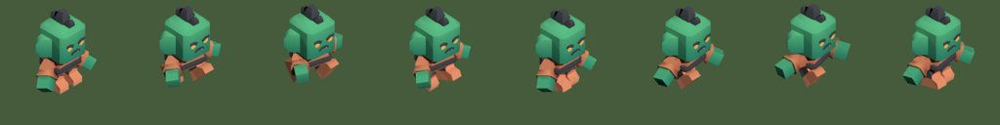
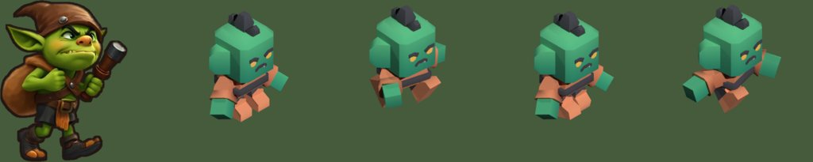

# Konzept: Figuren mit echten Gliedmaßen (FX 02)

Status: **[VORSCHLAG]** · Stand 26.10.2026 · Thread „Animationen und Effekte
hochwertig machen", zusammen mit dem Grafik-Thread
Grundlage: D-051 (3D-Modelle zu Sprite-Blättern), D-016 (Stylized 3D),
[FX 01](fx-01-bewegung-und-effekte.md#stufe-2-echte-gliedmaßen-entschieden-3d-zu-sprite-blättern-d-051),
[Figurenblätter](../art/figuren.md), [Asset-Vertrag](../art/asset-vertrag.md),
[Marktanalyse](../game-design/market-analysis.md) Abschnitt 3 „AAA-Anmutung".

## Ziel

Plünderer, Flitzer und Panzerbestie bewegen Arme und Beine, statt als ein
starres Bild zu hüpfen. Sie sehen dabei aus wie die gemalten Figuren, die
Steffen kennt: dieselbe Silhouette, dieselben Farben, derselbe Charakter.
Ein Gegner hat einen Laufzyklus, einen Treffer-Zucker und einen Sturz beim Tod.

## Probe vom 26.10.2026 (gemessen)

Bevor dieses Konzept etwas verspricht, lief der Weg einmal durch:

- Blender 5.2 läuft als Python-Paket (`bpy`) ohne Bildschirm und ohne
  Grafikkarte im Linux-Container. 8 Bilder eines Laufzyklus in 256 × 256 Pixeln
  rendern in **7 Sekunden** (Cycles auf der CPU, 24 Samples).
- Testfigur: der Ork aus Kenneys „Mini Dungeon" (CC0), mit fertigem Skelett und
  Laufanimation. Kamera orthografisch, 35° von oben, Figur um 45° gedreht, damit
  sie nach rechts läuft und ihr Gesicht zeigt.
- Ergebnis: Arme und Beine schwingen sauber, kein Flackern, weil jedes Bild
  dasselbe Modell ist (das Problem gemalter Laufzyklen ist damit gelöst).



**Aber:** Neben unserem gemalten Plünderer wirkt das Baukastenmodell grob und
fremd. Ein fertiges Modell aus einem Baukasten ist also kein Weg für das Spiel,
höchstens für Prüfungen der Werkzeugkette.



Skript der Probe: [`art/fx-02/spike-render.py`](../../art/fx-02/spike-render.py).

## Woher die Modelle kommen [OFFEN, Entscheidung Steffen]

| Weg | Was | Aussehen | Risiko |
|---|---|---|---|
| **A: Unsere Figur zu 3D (Empfehlung)** | Das gemalte Bild (`art/spielfeld/enemy_*-frei.png`) geht durch TRELLIS (Microsoft, MIT-Lizenz), heraus kommt ein texturiertes Modell. Skelett und Bewegungen setzt ein Skript in Blender. | am nächsten an den gemalten Figuren | TRELLIS braucht eine große Grafikkarte. Hier gibt es keine. Entweder läuft es über die öffentliche Hugging-Face-Seite (unser Bild wird dort hochgeladen; es liegt ohnehin im öffentlichen Repo) oder auf einer gemieteten Grafikkarte (wenige Euro je Lauf). Das Modell kann an Händen und Rücken unsauber sein und braucht Nacharbeit. |
| B: Fertiges Modell aus einem CC0-Baukasten | Kenney, Quaternius, KayKit: fertig mit Skelett und Animationen | grob, passt nicht zum gemalten Stil (siehe Vergleich oben) | kein technisches Risiko, aber sichtbar billiger |
| C: Selbst gebaut per Skript | Ich setze die Figur in Blender aus Grundkörpern zusammen und bemale sie | wie B, eher klotzig | kein Hochladen, aber derselbe Stilbruch |

Hunyuan3D-2 (schließt die EU aus) und Stable Fast 3D (Umsatzgrenze) fallen aus,
siehe Grafik-Thread. Mixamo bleibt ein späterer Ausweg fürs Skelett, braucht
aber ein Adobe-Konto von Steffen; im Repo lägen dann nur die gerenderten Bilder.

**Empfehlung A**, in zwei Schritten: erst der Plünderer allein bis zum
fertigen Sprite-Blatt, dann entscheidet Steffen am Bild, ob Flitzer und
Panzerbestie folgen. Fällt der Plünderer durch, bleibt das Spiel bei Stufe 1
(FX 01) und nichts im Spiel ist verloren.

## Werkzeugkette

```
art/spielfeld/enemy_raider-frei.png
        │ TRELLIS (einmal, Ergebnis eingecheckt)
        ▼
art/figuren-3d/enemy_raider/modell.glb ──▶ tools/figuren-3d/rig.py   Skelett aus rig.json, automatische Gewichte
        │                                         │
        │                                         ▼
        │                              tools/figuren-3d/bewegung.py   Laufen, Zucken, Sturz als Schlüsselbilder
        │                                         │
        ▼                                         ▼
                 tools/figuren-3d/render.py   Kamera 35° von oben, 45° gedreht, Fuß bei 0,1
                                  │
                                  ▼
          Nachbearbeitung wie freistellen.py: Kontur, Farbangleich an die Gemälde
                                  │
                                  ▼
     App/Assets.xcassets/Battle.spriteatlas/enemy_raider_walk_00 … _07, _hit_00 … , _die_00 …
                                  │
                                  ▼
                 tools/art-check/check_assets.py prüft Anzahl, Größe, Anker
```

- **Was eingecheckt wird:** das Modell (`.glb`), `rig.json` (Gelenkpunkte je
  Figur), die Skripte und die fertigen Bilder. Gerendert wird bei mir, nicht in
  der App und nicht im CI. Das CI prüft nur die fertigen Bilder.
- **Was nicht eingecheckt wird:** Blender selbst. `bpy` ist ein Werkzeug wie
  FLUX im Skill `spielgrafik`, es landet nicht in der App. Blender steht unter
  GPL; gerenderte Bilder sind davon nicht betroffen. Weil es eine neue
  Fremdsoftware ist, bekommt sie einen Eintrag im Entscheidungsprotokoll.
- **Bewegungen** stehen als Schlüsselbilder im Skript (`bewegung.py`): Laufen
  8 Bilder, Treffer 3, Tod 6. Gangart je Gegner wie in den Figurenblättern
  (Plünderer: Sack schwingt nach; Flitzer: flach und vorgekippt; Panzerbestie:
  schweres Stampfen).
- **Licht** von links oben wie in den Gemälden, damit Figuren und Türme
  zusammenpassen. Der Grafik-Thread legt Kontur und Farbangleich fest.

## Einbau in die App

| Baustein | Darf | Darf nicht |
|---|---|---|
| `FxMath.walkFrame(distance:stride:frames:)` (rein) | Bildnummer aus der zurückgelegten Strecke, damit die Füße nicht rutschen (dieselbe Grundlage wie das Hüpfen in FX 01) | Zeit oder Zufall verwenden |
| `FxTextures`/Atlas | Bildfolgen unter `enemy_<art>_walk_NN` laden | aus dem Netz laden |
| `EnemyNode` | Bild je Strecke wechseln; ohne Bildfolge das Standbild nehmen und wie bisher hüpfen | Simulationswerte berechnen |
| `FxDirector` | Treffer- und Sturzfolge abspielen statt Stauchen | Zustand anfassen |

Stufe 1 bleibt darunter: Schatten, Aufblitzen, Rauch, Münzen und
Lebensbalken hängen nicht am Bild. Mit Bildfolge wird das Hüpfen kleiner, weil
die Beine jetzt die Arbeit machen. Die Simulation ändert sich nicht.

## Größe der App

Eine Figur: 8 + 3 + 6 = 17 Bilder in @3x mit etwa 160 × 200 Pixeln, je rund
25 KB als PNG mit Alpha. Drei Gegner: etwa **1,3 MB**. Der Atlas heute: 440 KB.
Eine zweite Laufrichtung (nach oben/unten) würde das verdoppeln; die Karte von
Mission 1 läuft überwiegend seitlich, darum erst eine Richtung, gespiegelt.

## Sicherheit und Lizenzen

- Nur Modelle aus Weg A (eigene Bilder, TRELLIS unter MIT) oder CC0. Je Figur
  steht in `art/figuren-3d/<figur>/ENTSTEHUNG.md`: Quellbild, Werkzeug mit
  Version und Lizenz, Seed, Nacharbeit.
- Nichts wird zur Laufzeit geladen; die App kennt nur fertige Bilder.
- Hochladen zu Hugging Face erst nach Steffens Freigabe (Weg A, Variante
  öffentliche Seite).

## Testplan

- `FxMathTests`: Bildnummer wächst mit der Strecke, läuft im Kreis, hängt nicht
  an der Bildrate (einmal rot gesehen).
- `check_assets.py`: jede Bildfolge vollständig (keine Lücke in `_NN`), gleich
  groß, Fuß auf demselben Anker; neuer Fall in `tools/art-check/tests`.
- `AppTests`: `EnemyNode` wechselt beim Laufen das Bild, steht ein Gegner
  still, bleibt das Bild; fehlt die Folge, wird das Standbild gezeigt.
- `FxBudgetTests` und der Probelauf im Simulator: Bildrate bleibt über
  55 fps (heute 59,7), längstes Bild unter 50 ms.
- Sichtprüfung vor jeder Auslieferung: Bildschirmfotos aus dem Probelauf neben
  den gemalten Figuren.

## Offene Punkte

1. **Steffen:** Weg A, B oder C, und bei A: darf das Bild über die öffentliche
   Hugging-Face-Seite laufen, oder lieber eine gemietete Grafikkarte?
2. **Grafik-Thread:** Kontur, Farbangleich und Asset-Vertrag für Bildfolgen.
3. Türme bleiben vorerst gemalte Standbilder mit den Bewegungen aus FX 01.
