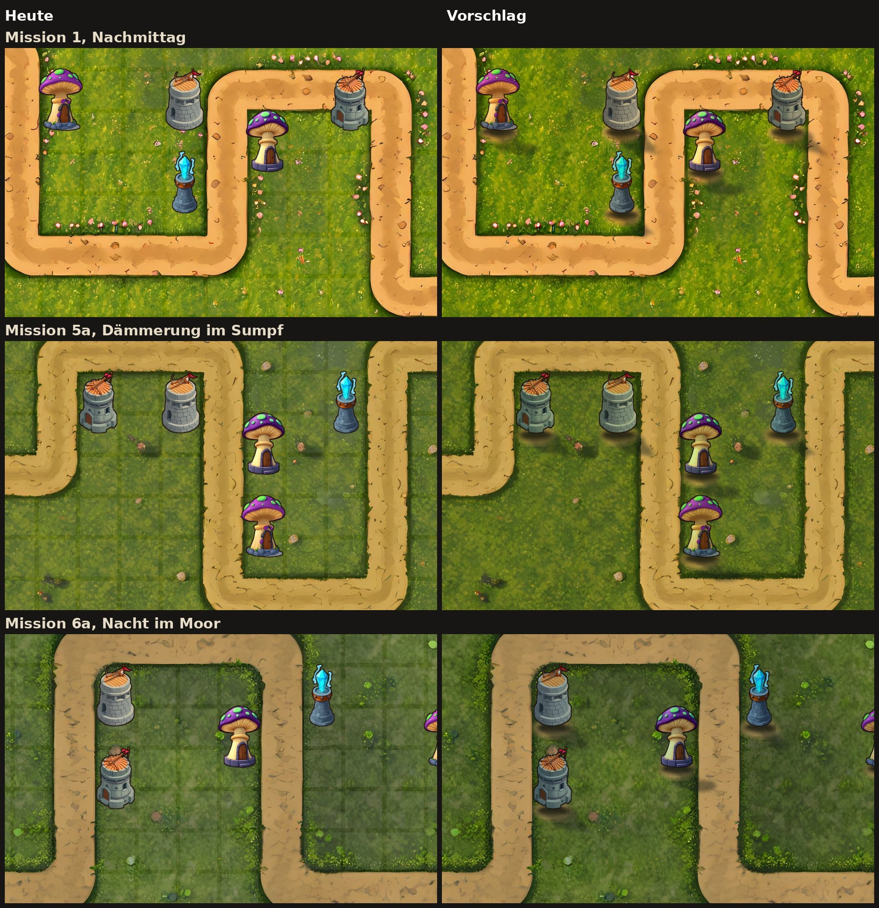

# Konzept: Türme stimmig in die Welt einfügen (Grafik 10)

Status: **umgesetzt in 0.29.1** · Stil D-016 · Thread „Türme stimmig in die Welt einfügen“
Anlass: Steffen am 08.11.2026: „die türme sehen nicht stimmig aus dass sie zur welt
gehören. das muss fließend aussehen dass es dann in der welt ist.“ Die Ansicht der
Aufwertungen mit Werten macht ein anderer Thread.

## Befund

Gemessen an M1, M5a und M6a (Bilder aus dem Atlas auf dem echten Boden):

1. **Kein Schatten.** Gegner haben eine Schattenellipse, Türme nichts. Sie schweben.
2. **Falsches Licht.** Jeder Kampfplatz ist beim Malen mit einem eigenen Lichtton
   multipliziert worden (`LICHT` in `kampfplatz.py`, von warmem Nachmittag bis Mondlicht).
   Die Türme stehen überall im neutralen Tageslicht des Freistellens; in 5a und 6a
   leuchten sie wie aufgeklebt.
3. **Kein Bodenkontakt.** Die Unterkante der Türme endet hart im Gras.
4. **Karomuster.** Die weißen Bauzonen (7 % Deckung, dauernd sichtbar) legen ein Raster
   über die gemalte Wiese. Das bricht den Eindruck „gemalter Ort“ am stärksten.

## Umfang

| Baustein | Was | Wo |
|---|---|---|
| Ortslicht (D-120) | Turmbild und Festung × Lichtton des Kampfplatzes | `App/Battle/kampfplatzlicht.json`, `BattlefieldLight`, `TowerNode.tint` |
| Schatten (D-120) | Kontaktellipse am Fuß und Schlagschatten nach unten rechts, aus dem Umriss jedes Turmbildes | `turmboden.py` → `tower_*_shadow` |
| Fundament (D-120) | Fleck festgetretene Erde unter jedem Turm, aus dem gemalten Weg derselben Karte | `turmboden.py` → `footing_<mission>` |
| Bauplätze (D-121, Karte S25 entschieden) | nur sichtbar, solange gebaut wird: vor der ersten Welle und mit gewählter leerer Zelle; belegte Zellen ohne Feld; abgerundet und deutlicher | `BattleScene.showBuildZones` |

Nicht im Umfang: Gegner bleiben ungetönt (Lesbarkeit geht vor, art-direction.md); neue
gemalte Turmbilder; Steinsockel je Ort (wäre FLUX-Arbeit je Kampfplatz, kann folgen,
wenn das Fundament aus Erde nicht reicht).

## Architektur

- **Kein Spielwert betroffen.** Alles ist Darstellung: die Simulation und ihre Tests
  bleiben unberührt (Architekturregel 1, 7).
- **Licht an einer Stelle.** `kampfplatzlicht.json` liegt bei der App (nicht in der
  Missionsdatei, die nur Spielwerte trägt). Der Test `test_licht_ist_das_licht_des_bodens`
  verlangt, dass jeder Wert in der Entstehung des Bodens steht; ändert jemand das eine,
  schlägt die CI an. Fehlt ein Eintrag (neuer Kampfplatz), bleibt der Turm ungetönt
  statt zu brechen, und `test_jeder_kampfplatz_hat_licht_und_fundament` meldet es.
- **Schatten und Fundament gerechnet.** Kein Modell, kein Zufall außer festem Seed:
  `test_skript_rechnet_gleich` rechnet beide neu und vergleicht pixelgenau mit dem Atlas.
  Neuer Turm, neue Stufe oder neuer Kampfplatz: Skript laufen lassen.
- **Ebenen.** Fundament und Schatten liegen in einer eigenen Ebene `shadeLayer`
  (z 3) unter Auswahl (5) und allen Türmen (10). So fällt kein Schatten über einen
  Nachbarturm, und die Auswahlmarkierung bleibt lesbar. `TowerNode.shade` gehört dem
  Turm, hängt aber in dieser Ebene; die Szene entfernt es mit dem Turm, beim Verkauf
  blendet es in der Dauer des Verkaufs aus. Beim Bau folgt es der Deckung des Turms
  (`idle`), erscheint also beim Aufsetzen, nicht vorher.
- **Bauplätze** liegen in `zoneLayer` (z 2) statt im Boden; eine Textur für alle Felder.
  Die Regel steht in `wantsBuildZones` (nur mit Bedienung, nie beim Zuschauen).
- **Leistung.** Je Turm zwei Sprites mehr, aus demselben Atlas, ohne Effektknoten oder
  Unschärfe zur Laufzeit. Die Tönung ist `colorBlendFactor`, kostet nichts extra.

## Bedienung

Karte S25 (08.11.2026): „Wann soll das Bauraster sichtbar sein?“ Optionen: nur beim
Bauen (Empfehlung), immer weicher, wie heute. Steffen hat am 08.11.2026 „nur beim
Bauen“ gewählt (D-121). Vor der ersten Welle stehen die Felder, damit man beim Einstieg sieht,
wo man bauen kann; die Hand des Einstiegs (P2-8) zeigt auf ein solches Feld.

## Sicherheit

Neue Eingabe von außen gibt es nicht. `kampfplatzlicht.json` liegt im Bündel; beim Laden
werden nur Einträge `mission-…` mit drei Werten 0 bis 255 übernommen, alles andere wird
übergangen (`testLightTableSkipsBrokenEntries`).

## Tests

| Test | Prüft |
|---|---|
| `TowerGroundingTests` (App) | Tabelle ignoriert Kaputtes; jede Kampagnenmission hat Licht und Fundament im Bündel; Turm getönt bzw. ungetönt; Schatten und Fundament da, Fundament unter dem Schatten, beides nicht am Turm; Schatten folgt dem Bau; Aufwerten tauscht den Schatten; Szene legt alles in die Schattenebene und räumt beim Neustart; Bauplätze vor der ersten Welle und mit Auswahl sichtbar, sonst nicht; nie beim Zuschauen |
| `TuermeInDerWelt` (art-check) | Schatten je Turmbild; Licht und Fundament je Kampfplatz; Licht = Licht des Bodens; Schatten fällt nach rechts unten, Kontakt am Fuß; Fundament ist warme Erde; Skript rechnet pixelgleich |
| `check_assets.py` | Größen der neuen Bilder gegen den Vertrag, Herkunft in `ENTSTEHUNG.md` |
