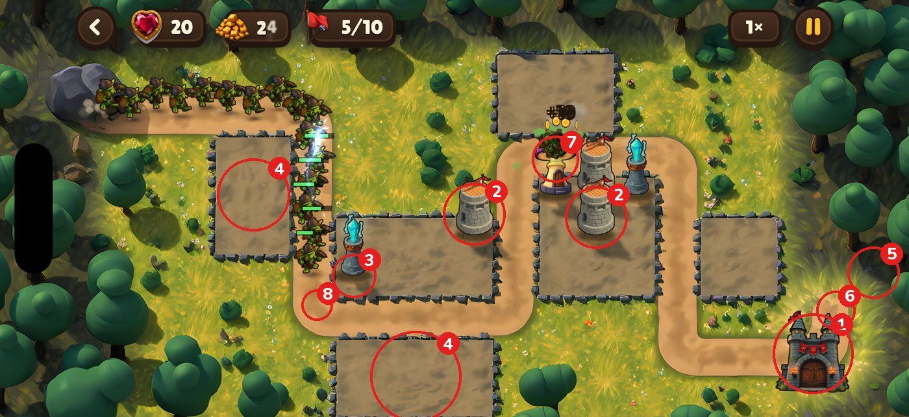
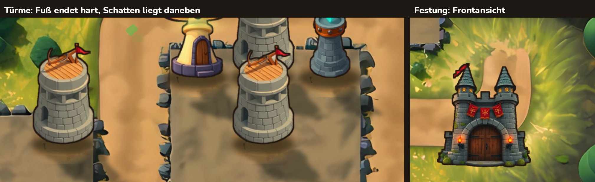
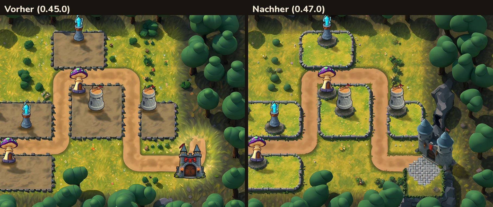

# Review und Konzept: Kampfplatz in der Welt (Grafik 11)

Status: **Review gemessen**, Maßnahmen entschieden (Karten S35 bis S37, 24.11.2026) ·
Stand 24.11.2026, Version 0.45.0 (Bau 66) · Thread „Kampfplatz immersiv in die Welt
einbetten“ · Nummern D-190 bis D-199 · Version 0.47.0

Anlass: Steffen am 24.11.2026: „es sieht noch nicht wirklich immersive aus. türme sieht
aus dass sie schweben und nicht auf dem boden sind. das ziel sieht aus dass es nicht zur
welt gehört. Mache ein ausführliches review und gehe die themen dann an.“

Grundlage: [AAA-Review](aaa-review.md) (G1, G2, G4), [A-4 Diorama](a-4-diorama-mission-1.md)
(D-165 Kamera, D-166 Maßstab), [Grafik 10](grafik-10-tuerme-in-der-welt.md) (D-120 Licht,
Schatten, Fundament), Marktanalyse Abschnitt 3 „AAA-Anmutung“. Geprüft mit dem Skill
[`aaa-pruefung`](../../.claude/skills/aaa-pruefung/SKILL.md).

## Wie geprüft wurde

- Simulatorbild `mission-1.png` aus dem CI-Artefakt `simulator-probe` vom 23.11.2026
  (main, 0.45.0), in voller Auflösung und in Ausschnitten.
- Die Atlasbilder `tower_*`, `tower_*_shadow`, `footing_mission01` und `fortress` einzeln
  auf Farbgrund, mit gemessenem Fußpunkt (Alpha) gegen den Anker im Vertrag.
- Der Diorama-Render `art/karten/diorama/mission01-render.jpg` vor dem Übermalen.
- Der Code, der die Dinge setzt: `BattleScene` (Festung), `BattleSprites.tower`,
  `TowerNode.shade`, `BattleStyle` (Seiten, Anker, Versatz), `tools/kampfplatz-3d`.





**Nachher** (0.47.0, aus den Atlasbildern wie in der Szene zusammengesetzt):



## Urteil in drei Sätzen

Die Lichtung selbst ist inzwischen ein Ort: eine Kamera, ein Licht, Wald als Rahmen,
Gegner mit Schatten auf einem gerundeten Weg. **Was nicht zu diesem Ort gehört, sind die
Dinge, die der Spieler baut oder verteidigt:** Die Türme stehen ohne Kontakt auf einer
leeren Erdfläche, und die Festung ist eine Frontansicht ohne Boden, hinter der der Weg
weiterläuft. **Die Bauinseln verstärken den Eindruck**, denn als leere, flache
Sandkästen mit Steinzaun lesen sie sich wie Baugruben, nicht wie Teile der Landschaft.

## Befunde, nach Gewicht

Gewicht wie im Review: **A** bricht den Eindruck in jeder Sekunde · **B** fällt jedem
Spieler mehrmals auf · **C** fällt Kennern auf. Nummern wie im markierten Bild.

| # | Gew. | Befund | Beleg | Ursache |
|---|---|---|---|---|
| W1 | A | **Die Festung ist eine Frontansicht.** Sie ist gerade von vorn gemalt (0°), Türme, Figuren und Lichtung aus 40°. Ihr Tor zeigt zum Spieler, der Weg kommt aber von links. Sie hat keinen Boden, keinen Schatten, keine Mauer, die sie mit dem Wald verbindet, und steht frei in einem hellen Lichthof. | Bild a (1), Bild b rechts; `fortress.png` | Bild aus Grafik 01 (vor D-165), nie in die Kamera geholt; `BattleScene` setzt es mit Versatz in den Rand, ohne Bodenteil |
| W2 | A | **Der Weg endet nicht am Tor.** Er läuft hinter der Festung nach oben weiter und verliert sich im Lichthof. Wohin die Gegner wollen, sieht man nicht. | Bild a (6), Bild b rechts | `plan.py` legt den Festungsplatz als helle Ellipse um `fest`, der Weg wird bis `fest.x` gezogen, die Festung sitzt 0,9 Felder tiefer |
| W3 | A | **Türme schweben.** Der Fuß endet als harte dunkle Konturlinie auf flacher Erde. Der Schlagschatten ist weich und liegt daneben (rechts unten), unter dem Fuß ist es kaum dunkler als daneben. Der dunkle Kontakt, den ein schweres Steinding am Boden macht, ist zu schwach und zu weich. | Bild a (2), Bild b links | `tower_*_shadow` trägt nur eine schwache, breite Kontaktellipse (0,95 × 0,36 Felder, Deckung 67 %), die zum Schlagschatten gehört und nicht unter dem Fuß sitzt; Kontur aus `freistellen.py` umläuft auch den Fuß |
| W4 | A | **Das Fundament ist unsichtbar und hat Kratzer.** `footing_mission01` ist Erde aus dem Weg, auf Erdinseln also Erde auf Erde. Dafür sieht man seine dunklen Häkchen (Artefakte aus der Wegtextur) unter jedem Turm. | Bild b links, kleine Striche unter den Türmen | `turmboden.py` schneidet das Fundament aus dem gemalten Weg; seit A-4 stehen alle Türme auf Erde |
| W5 | A | **Bauinseln sind leere Sandkästen.** Sechs Rechtecke aus gleichförmiger Erde mit einer Reihe Feldsteine, scharfe rechte Winkel, kein Gras, keine Spur von Nutzung. Unbebaut nehmen sie ein Drittel der Lichtung ein und sehen aus wie Baugruben oder abgerissene Häuser. Die Höhe von 0,09 Feldern ist im Bild kaum zu sehen. | Bild a (4), `mission01-render.jpg` | `plan.py`: Insel = Erdtextur, Rand = Kantensteine, `inselhoehe` 0,09 |
| W6 | B | **Ein Lichthof hinter der Festung.** Gelbgrüner Strahlenkranz um die Festung, wie ein Heiligenschein. Er macht sie zum Aufkleber auf einem Spot, statt zu einem Gebäude im selben Nachmittagslicht. | Bild a (5) | Übermalen hat die helle Festungsellipse aus `plan.py` als Lichtquelle gedeutet |
| W7 | B | **Zwei Malweisen bei den Türmen.** Der Sporenturm ist ein Comicpilz mit dicker lila Kontur, Wach- und Blitzturm sind gemalter Stein. | Bild a (7) | Sporenturm aus Grafik 02 nie nachgemalt; gehört in A-5 (Turmbilder), hier nur vermerkt |
| W8 | B | **Harte Wegkante.** Zwischen Weg und Gras liegt eine scharfe, glatte Linie; kein Gras hängt über, keine Steinchen, keine Fahrspur. | Bild a (8) | Wegmaske mit 0,03 Feldern Weichheit; Übermalen hat sie geglättet |
| W9 | C | **Maßstab der Festung.** Sie ist sichtbar etwa 2 Felder hoch, der Vertrag verlangt 2,6 (D-166); ein Wachturm daneben ist fast so groß. | Bild a, `fortressSpriteSide` 2,4 | Bild noch nicht auf den Zielmaßstab gebracht |
| W10 | C | **Turmbilder in 45°, Boden in 40°.** Bei Wachtürmen fällt das kaum auf, bei der Festung (0°) sehr. | Vertrag `kamera`, Bild b | Turmbilder vor D-165 gemalt; Abweichung bis 10° ist erlaubt (`figurenSpielraum`) |

**Was gut ist und bleiben muss:** der dunkle Waldrand als Rahmen und die helle Lichtung
(Blick bleibt auf dem Feld); die Höhle, aus der die Gegner kommen; Gegner mit
Bodenschatten in Laufrichtung; Licht von links hinten, Schatten nach rechts unten, überall
gleich; die schwebenden Holzschilder der Kopfleiste.

## Wie AAA-Titel das lösen

Kingdom Rush, Bloons und Clash of Clans erden Gebautes mit denselben vier Mitteln, und
keines davon fehlt dort je:

1. **Kontaktdunkel.** Ein enger, dunkler Fleck genau unter dem Fuß (Ambient Occlusion),
   unabhängig vom Schlagschatten. Er ist es, der „steht“ sagt; der Schlagschatten sagt nur,
   woher das Licht kommt.
2. **Ein Sockel aus der Welt.** Türme stehen auf einer Steinplatte oder einem Erdhügel,
   der breiter ist als der Turm und dessen Vorderkante man sieht. Der Bauplatz wird so zum
   Ding, nicht zur Fläche.
3. **Der Boden greift über den Fuß.** Gras, Steinchen oder Staub liegen vor dem Fuß und
   verdecken die Unterkante. So endet ein Bild nie mit einer harten Linie am Boden.
4. **Das Ziel ist Teil der Karte.** Die Festung ist in den Boden gebaut (Mauern, Vorplatz,
   Weg bis ins Tor), nur ihre bewegten Teile sind eigene Bilder.

## Maßnahmen

| Paket | Was | Befunde | Entscheidung |
|---|---|---|---|
| **M-1 Turmfuß** | Jeder Turm steht auf einem Steinsockel aus dem Diorama-Werkzeug (Blender, Vertragskamera und -sonne, übermalt): runde Platte, etwas breiter als der Turm, Vorderkante sichtbar, darauf ein Kontaktdunkel unter dem Fuß. Der Turm rückt um die Sockelhöhe nach oben. Das Fundament aus Wegerde entfällt. | W3, W4 | **S35 / D-190** |
| **M-2 Kontakt** | Neues Bild `tower_contact`: enges Kontaktdunkel (multiplizierend) unter jedem Turm und unter der Festung, getrennt vom Schlagschatten, der bleibt. Gilt mit und ohne Sockel. | W3 | D-193 (Claude) |
| **M-3 Festung** | Torburg neu im Diorama gebaut: in der Vertragskamera, schräg gestellt, Tor zum ankommenden Weg; Mauerzüge links und rechts bis in den Wald, gepflasterter Vorplatz, der Weg endet im Tor. Ins Bodenbild gerendert; die Torburg selbst als eigenes Bild obenauf (für Durchbruch-Effekte), auf Zielmaßstab 2,6. | W1, W2, W9, W10 | **S36 / D-191** |
| **M-4 Bauinseln** | Inseln werden flache Grashügel mit niedriger Trockenmauer statt Erdflächen: gerundete Ecken, sichtbare Stirnseite, Gras mit Trittspuren. Wo ein Turm steht, trägt der Sockel (M-1) die Erde; beim Bauen leuchten die Zellen wie bisher (D-121, D-157). | W5 | **S37 / D-192** |
| **M-5 Licht und Weg** | Lichthof weg (die Festung steht im selben Nachmittagslicht wie alles), Weg bis ins Tor, Wegrand mit Grasbüscheln und Kieseln, keine harte Linie. | W2, W6, W8 | D-194 (Claude) |
| **M-6 Prüfung** | Art-check und App-Tests, die Erdung messen (siehe Tests). | alle | D-195 (Claude) |

Nicht in diesem Paket: Sporenturm nachmalen (W7, gehört zu den Turmbildern von A-5) und
Turmbilder auf 40° (W10, gering, gleiche Familie). Beides steht in der Roadmap.

Alles gilt zunächst für **Mission 1** (Vertikalschnitt, D-142). Das Werkzeug wird so
gebaut, dass M2 bis M7 es als Dioramen bekommen (A-6/A-7), ohne neue Entscheidungen.

## Architektur

```
asset-vertrag.json (kamera, sonne, massstab)
        │
tools/kampfplatz-3d/
  plan.py      Festungsplatz (Vorplatz, Mauerzüge, Torlage) + Inselgestalt  ──► plan.json, boden.png
  diorama.py   Inseln als Grashügel mit Trockenmauer, Festungsmauern          ──► Bodenbild (übermalt)
  sockel.py    Turmsockel und Torburg einzeln, freigestellt, gleiche Kamera  ──► tower_plinth, fortress
        │
turmboden.py   tower_contact (Kontaktdunkel), Schatten wie bisher
        │
App/Battle
  BattleStyle  plinthSide, plinthLift, contactSide, Festungsmaße (alle Darstellung)
  TowerNode    shade = [Kontakt, Schlagschatten]; Sockel in der Schattenebene unter dem Turm;
               Bild um plinthLift angehoben
  BattleScene  Festung: Kontakt + Bild an der Torlage aus `FortressPlacement`
```

- **Keine Spielregel betroffen.** Simulation, Missionsdateien, Balance und Prüfsummen
  bleiben gleich (Architekturregel 1, 7). Gegner zielen weiter auf denselben Wegpunkt.
- **Ebenen.** Sockel und Kontakt liegen in `shadeLayer` (z 3), unter Auswahlring (5) und
  Türmen (10). Ein Sockel überdeckt so nie einen Nachbarturm; die Auswahl bleibt lesbar.
- **Torlage an einer Stelle.** Wo die Festung steht und wohin ihr Tor zeigt, rechnet eine
  reine Funktion (`FortressPlacement`) aus dem Wegende. Werkzeug (Python) und App lesen
  dieselben Werte aus `art/asset-vertrag.json` (`festung`), ein Test hält beide gleich.
- **Rückfall.** Fehlt `tower_plinth` im Katalog (andere Missionen, bis sie Dioramen sind),
  steht der Turm wie bisher auf seinem Fundament, nur mit Kontaktdunkel. Fehlt die neue
  Torburg, bleibt das alte Bild.
- **Leistung.** Je Turm ein Sprite mehr (Kontakt), Sockel ersetzt das Fundament. Keine
  Effektknoten, keine Laufzeitunschärfe.

## Bedienentscheidungen

- Ein Turm mit Sockel bleibt an derselben Zelle; Tippfläche und Auswahlring unverändert.
- Der Sockel erscheint mit dem Turm (Bauauftritt A-2): Er wächst nicht, sondern liegt,
  wenn der Turm aufsetzt, wie heute Schatten und Fundament. Beim Verkauf blendet er mit aus.
- Die Vorschau beim Bauen (D-155) zeigt den Sockel mit, blass wie den Turm.

## Sicherheit

Keine neue Eingabe von außen. Neue Bilder liegen im Bündel, Herkunft in
`art/karten/ENTSTEHUNG.md`; der Vertrag wird beim Bau von `check_assets.py` geprüft.

## Tests

| Ebene | Test |
|---|---|
| Werkzeug | `tools/kampfplatz-3d/tests`: Weglinie endet am Tor; Mauerzüge berühren weder Weg noch Insel; Inselgestalt deckt genau die Zellen |
| Bild (art-check) | Sockel und Kontakt im Atlas mit Herkunft; Kontaktdunkel dunkler in der Mitte als am Rand; Festung im Zielmaßstab (Reihenfolge D-166); Festungsbild nicht mehr frontal (Dachfläche sichtbar: obere Bildhälfte mit Draufsicht) |
| App | `WorldGroundingTests`: jeder Turm hat Kontakt, mit Sockel ist das Bild um `plinthLift` angehoben, Sockel unter dem Turm und in der Schattenebene, Verkauf entfernt alles; Festung hat Kontakt und steht an der Torlage aus `FortressPlacement`; ohne Sockelbild Rückfall aufs Fundament |
| E2E | Ein Turm wird gebaut und verkauft; die Szene meldet Sockel und Kontakt über die Zugänglichkeitskennung des Kampfes (wie A-2) |
| Ansehen | Vorher-nachher am echten Ort im PR, Kontaktabzug der CI |

## Entscheidungen

| Nr. | Was | Stand |
|---|---|---|
| D-190 | Turmfuß: Steinsockel unter jedem Turm | ENTSCHIEDEN (Steffen, 24.11.2026, Karte S35) |
| D-191 | Festung als Torburg im Diorama, Tor zum Weg, Mauern in den Wald | ENTSCHIEDEN (Steffen, 24.11.2026, Karte S36) |
| D-192 | Bauinseln als Grashügel mit Trockenmauer | ENTSCHIEDEN (Steffen, 24.11.2026, Karte S37) |
| D-193 | Kontaktdunkel unter allem Gebauten, getrennt vom Schlagschatten | gilt (Claude, Darstellung) |
| D-194 | Kein Lichthof um die Festung, Weg endet im Tor, Wegrand ohne harte Linie | gilt (Claude, Darstellung) |
| D-195 | Erdung wird geprüft (art-check und App-Tests oben) | gilt (Claude, Prüfung) |
